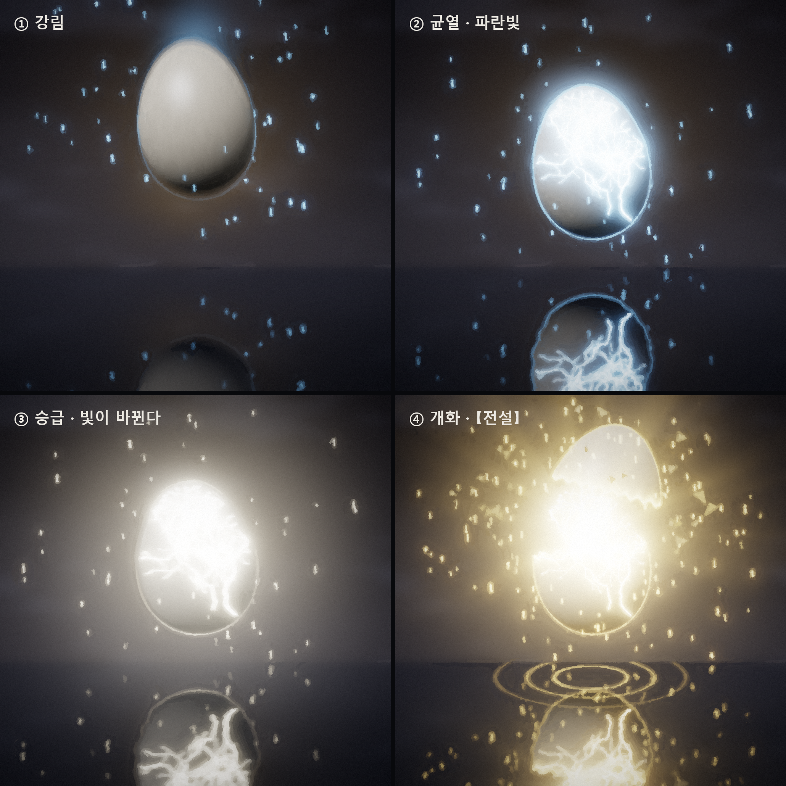
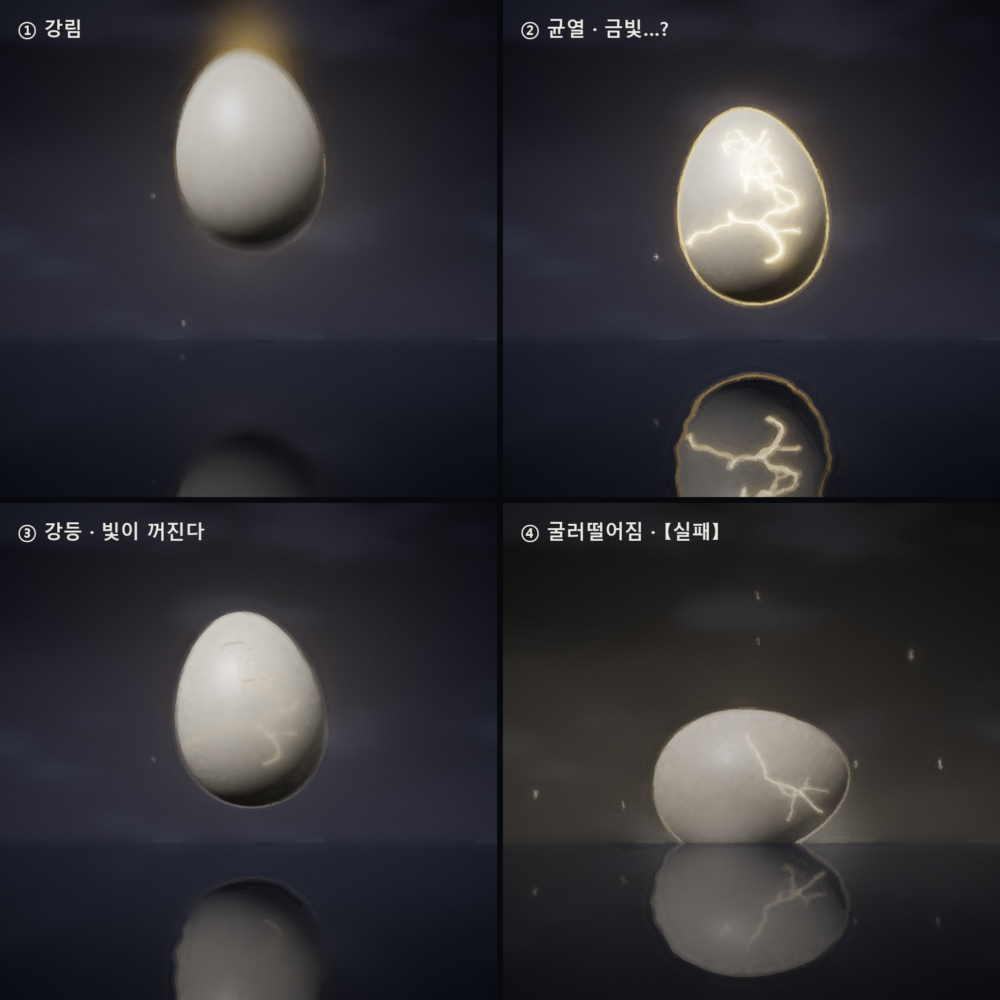
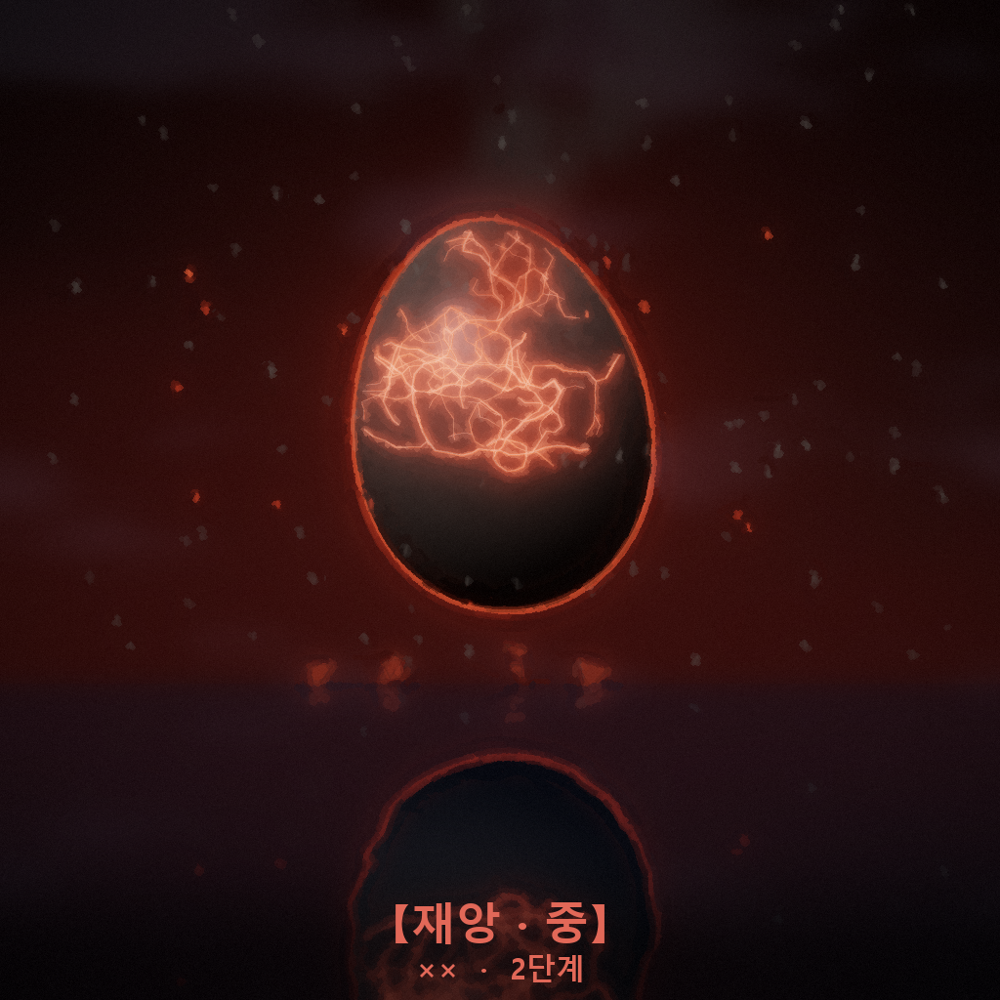
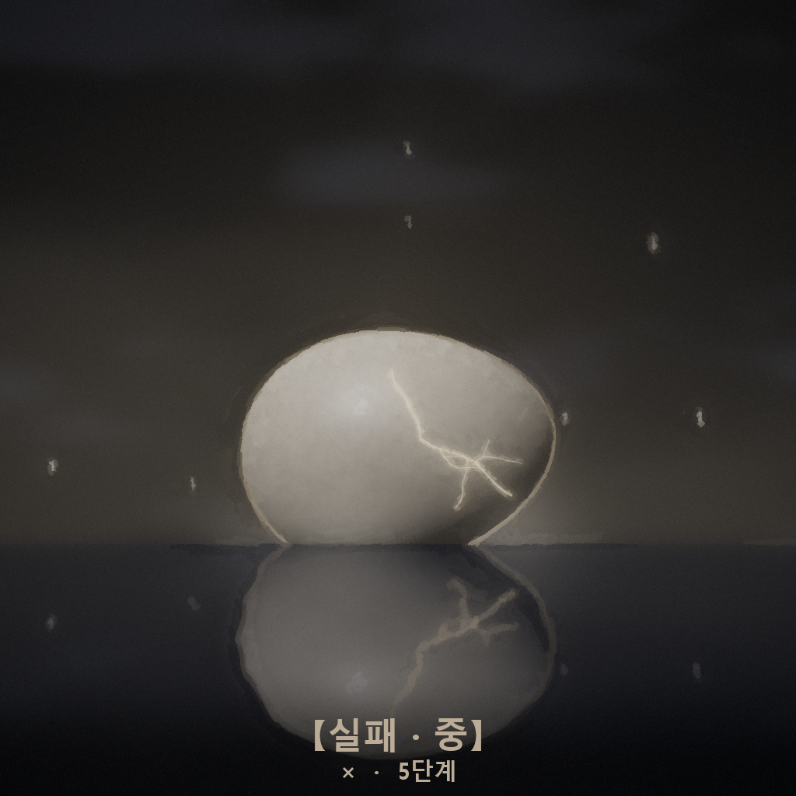
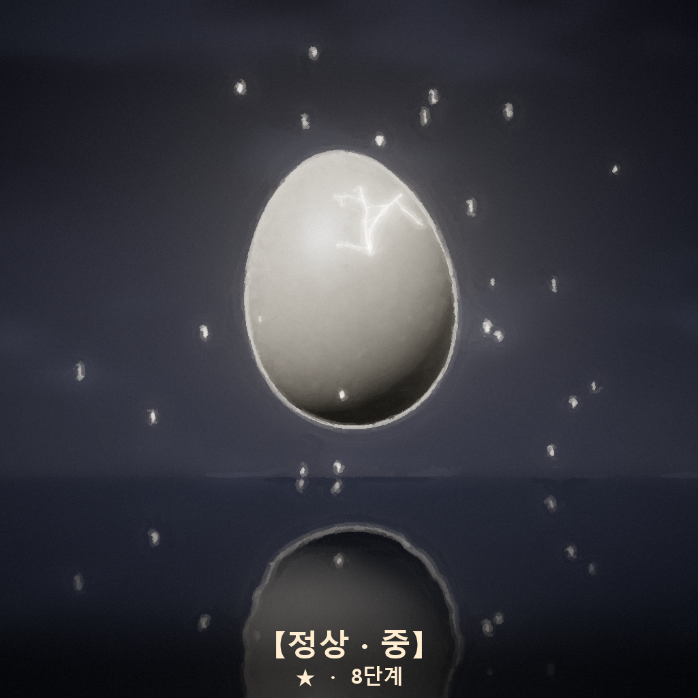
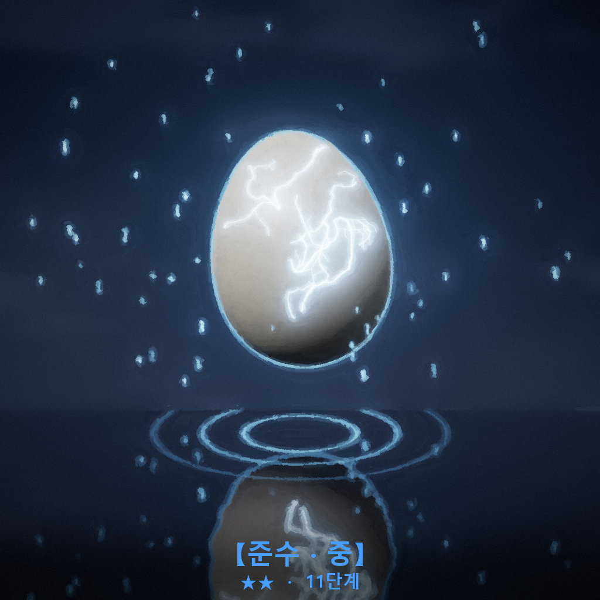
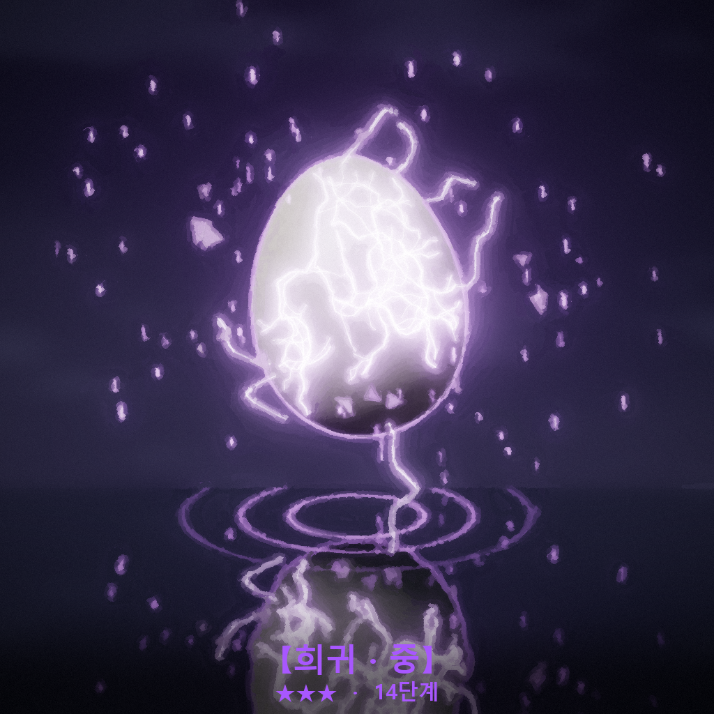
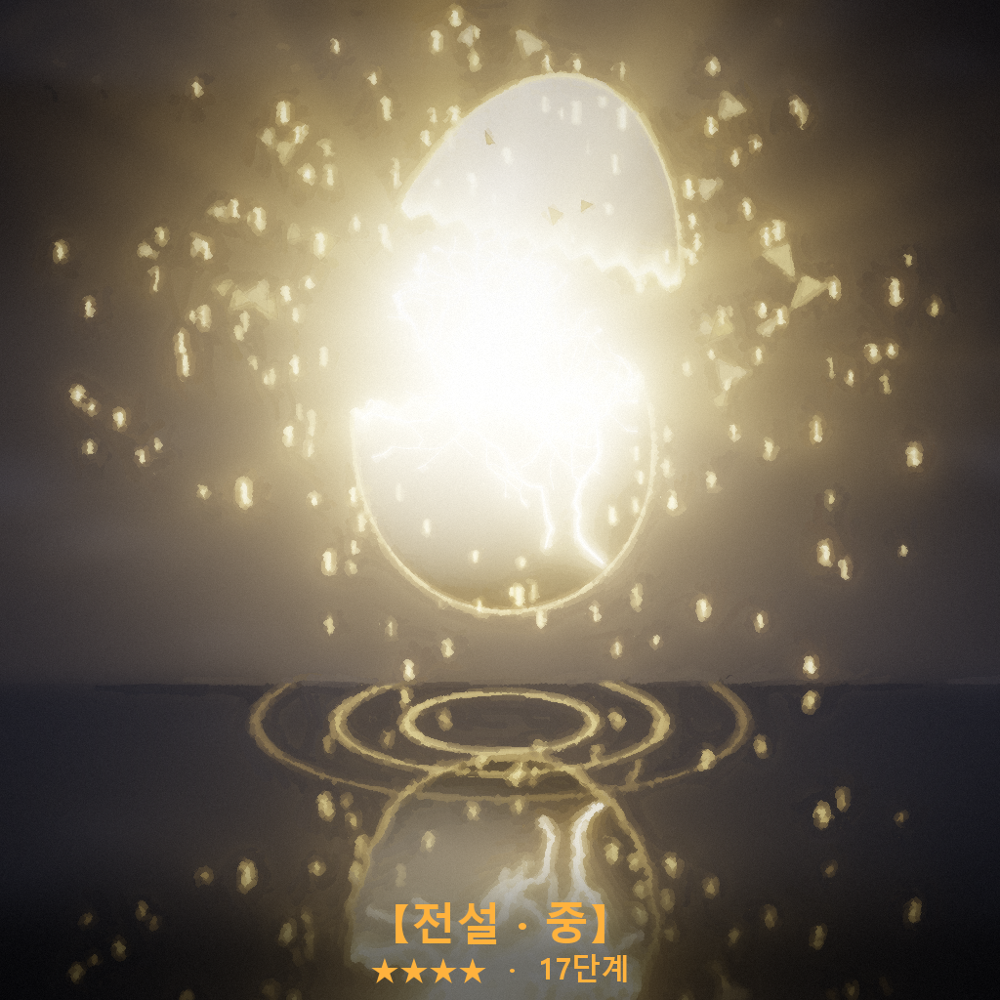
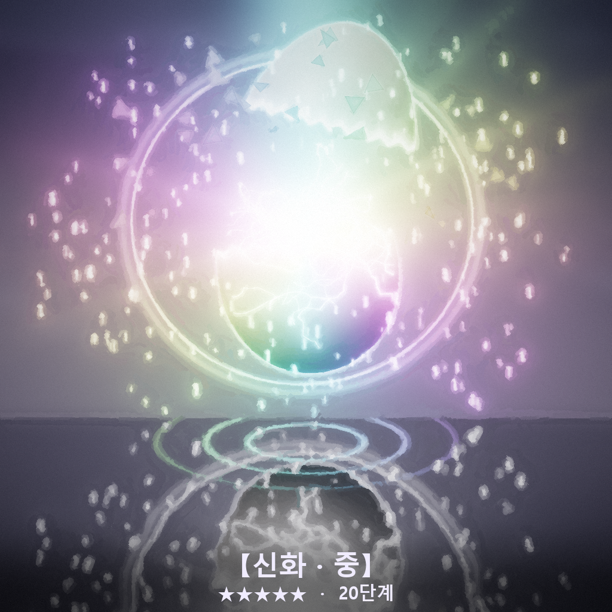
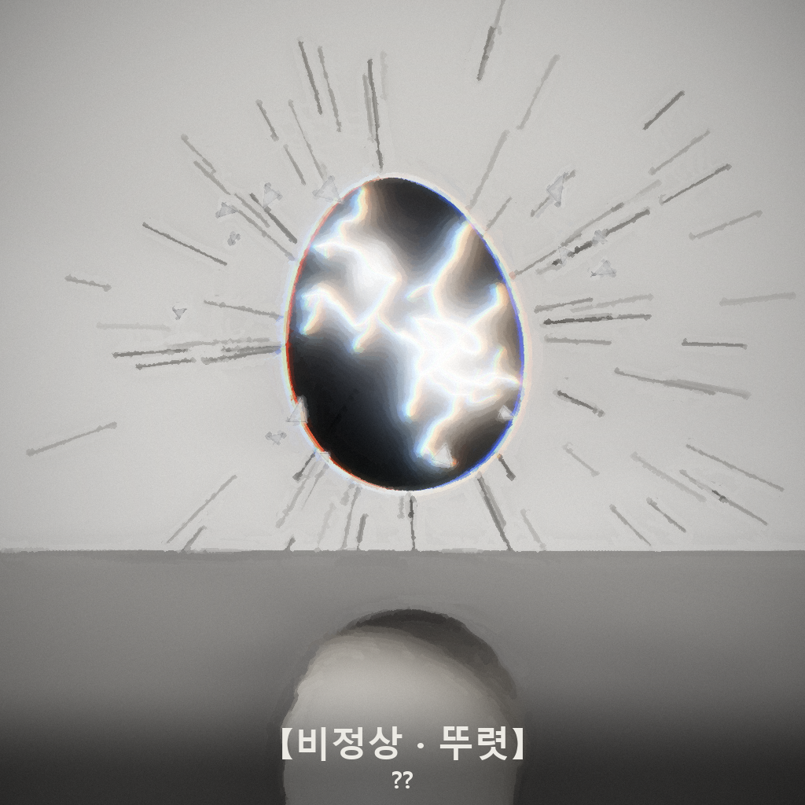

# 삼신 가챠 설계

'정상'의 출생·성장 가챠 시스템이다. 크랙 프롬프트에 붙일 완성본은 [`prompt/gacha_block.txt`](../prompt/gacha_block.txt)에 있다. 이 문서는 왜 그렇게 정했는지를 정리한다.

## 컨셉

- 아이는 삼신할미가 내려보내는 **알**을 깨고 태어난다. 난생설화에서 가져온 설정이고, 0살 출생 시작과 바로 이어진다.
- 알은 좋은 것만 주지 않는다. **실패와 재앙도 알에서 나온다.** 대신 실패는 보상(복)과 극복 루트를 남긴다.
- 챗 이름이 '정상'이라서 사다리 바깥에 **비정상**을 따로 둔다. 초현실 요소는 전부 여기로 모은다.

## 21단계 사다리

7등급 × 하·중·상 = 21단계다. 비정상은 사다리 밖에서 미세·뚜렷·세계급 3단계를 가진다.

| 단계 | 등급 | 표시 | 1차 기본 확률 | 세부 분할 (d100) | 재능 보정 범위 |
|---|---|---|---|---|---|
| 1–3 | 재앙 | ✕✕ | 3% | 하 15 · 중 35 · 상 50 | -20 ~ -10, 성장 ×0.80~0.90 |
| 4–6 | 실패 | ✕ | 12% | 하 15 · 중 35 · 상 50 | -8 ~ -2, ×0.92~0.98 |
| 7–9 | 정상 | ★ | 45% | 하 30 · 중 40 · 상 30 | +1 ~ +5 |
| 10–12 | 준수 | ★★ | 24% | 하 50 · 중 35 · 상 15 | +7 ~ +11, ×1.05~1.15 |
| 13–15 | 희귀 | ★★★ | 11% | 하 50 · 중 35 · 상 15 | +14 ~ +20, ×1.2~1.3 |
| 16–18 | 전설 | ★★★★ | 3.5% | 하 55 · 중 33 · 상 12 | +24 ~ +32, ×1.4~1.6 |
| 19–21 | 신화 | ★★★★★ | 0.5% | 하 60 · 중 32 · 상 8 | +38 ~ +55, ×1.8~2.5 |
| — | 비정상 | ?? | 1% | 미세 60 · 뚜렷 30 · 세계급 10 | 초현실 효과 + 대가 |

단계별 정확한 값은 프롬프트 8.3의 표에 있다. 세부 분할은 '극단일수록 드물게' 원칙을 따른다. 좋은 등급은 상이 드물고, 나쁜 등급은 하(최악)가 드물다.

## 시뮬레이션 결과

천장까지 포함해 1인당 9뽑(출생 5 + 성장 4)으로 20만 명을 돌렸다 (`python tools/gacha_sim.py`).

| | 재앙 | 실패 | 정상 | 준수 | 희귀 | 전설 | 신화 | 비정상 |
|---|---|---|---|---|---|---|---|---|
| 실효 확률 | 2.23% | 10.11% | 43.14% | 24.25% | 14.18% | 4.44% | 0.63% | 1.02% |
| 평생 1장 이상 | 19.0% | 62.7% | 99.4% | 92.6% | 80.1% | 34.4% | 5.5% | 8.8% |

- 가장 드문 결과는 신화·상(0.050%, 2000장에 1장)이고, 그다음이 비정상·세계급(0.097%)이다.
- 출생 5연차의 최고 등급(비정상 제외): 준수 32.4% · 희귀 45.2% · 전설 19.2% · 신화 3.0%. 정상 이하로 끝나는 출생은 비정상이 끼어든 0.3%뿐이다.
- 실패·재앙 보상으로 받는 복은 1인 평균 14.1이다. 혼자서 추가 뽑기를 열어 주진 않고, 운 나쁜 인생일수록 복 100에 빨리 닿는 정도다.

## 굴림 (두 번)

크랙 모델이 확률을 머리로 계산하면 틀리고, 극적인 결과 쪽으로 쏠린다. 그래서 이렇게 한다.
1. 1차 1~10000 → 프롬프트에 박아 둔 **눈치 게이지별 구간표**에서 등급을 찾는다.
2. 2차 1~100 → 등급별 고정 분할에서 하·중·상을 찾는다.
3. 등급과 단계를 먼저 정하고, 내용은 그다음에 만든다.
4. 두 굴림값을 카드에 그대로 보여 준다. 플레이어가 확인할 수 있게 하는 게 공정함의 체감이다.

구간표는 전부 `gacha_sim.py`가 계산한다. 규칙을 바꾸면 그 파일을 고치고 표를 다시 뽑는다.

**한계:** LLM이 고르는 '무작위' 숫자는 완전한 무작위가 아니다. 출시 전에 30~50번 테스트 뽑기를 해서 등급 분포를 세어 보길 권한다. 이번 구간 배치에선 재앙이 9701 이상의 큰 숫자 쪽에, 비정상·신화가 작은 숫자 쪽에 있다. 모델이 극단적인 숫자를 피하면 양 끝 등급이 덜 나오고, 즐겨 고르면 더 나온다. 쏠림이 보이면 구간 위치를 섞는 게 첫 번째 조정 포인트다.

## 천장 (눈치 게이지)

- 재앙·실패 +2 / 정상·준수 +1 / 희귀·전설·신화가 나오면 0으로 돌아간다. 비정상은 그대로다. 최대 10.
- 게이지 1당 희귀 +1.2%p, 전설 +0.35%p, 신화 +0.05%p가 붙는다. 그만큼 실패(-0.8), 정상(-0.5), 재앙(-0.3)에서 빠진다. 운이 나쁠수록 다음 장의 실패 확률도 같이 내려간다.
- 눈치 10이면 다음 1장은 희귀 76% / 전설 21% / 신화 3%로 확정이다.
- 전설·신화 없이 40장을 뽑으면 다음 1장은 전설 확정이다(9뽑 인생에선 거의 발동하지 않는 안전장치).
- 출생 보장: 출생 5연차의 앞 4장에 준수 이상이 없으면 5번째 장은 재앙·실패·정상이 빠진 표를 쓴다. 출생에서 두 번째 재앙은 실패·하로 감면한다.

## 실패·재앙 설계

- **삼신의 사과:** 실패는 복 +10, 재앙은 복 +25를 준다. 1년 적립 한도와 별개다.
- **극복:** 카드마다 서사로 이룰 수 있는 조건을 하나 붙인다. 이루면 실패는 준수로, 재앙은 희귀로 뒤집힌다(하·중·상 유지). "흉터가 재능이 된다." 부모·인연은 관계 회복이 극복이고, 이루면 화목 +2★가 된다.
- **톤:** 실패는 흔한 약점(박치, 잔소리 엄마), 재앙은 인생에 그림자를 드리우는 결핍(빚더미, 집에 없는 부모)이다. 학대·폭력·성적 내용은 쓰지 않는다. 비극 포르노로 쓰지 않는다.

## 연출 (한 장 = 네 박자)

| 승급 (전설) | 강등 (실패) |
|---|---|
|  |  |

1. **강림**: 알이 내려온다. 매번 다른 방식으로.
2. **균열**: 금 사이로 새는 빛의 색이 등급 예고다.
3. **변화**
   - 승급: 희귀 이상이고 1차 굴림값이 3의 배수면 한 등급 낮은 빛에서 올라간다. 신화는 항상 두 번 승급한다.
   - 강등: 실패·재앙이고 1차 굴림값이 4의 배수면 좋은 빛인 척하다가 꺼진다.
   - 비정상: 흰빛인 척하다가 빛이 거꾸로 빨려 들어간다.
4. **개화**: 알이 깨지고(실패는 깨지다 말고 굴러떨어진다) 단계 이미지와 결과 카드가 뜬다. 세부가 '상'이면 한 박자를 더한다.

## 단계 이미지 24장

`art/out/steps/`에 `01_재앙_하.png` ~ `21_신화_상.png`, `22_비정상_미세.png` ~ `24_비정상_세계급.png`가 있다.

| 재앙 | 실패 | 정상 | 준수 |
|---|---|---|---|
|  |  |  |  |
| **희귀** | **전설** | **신화** | **비정상** |
|  |  |  |  |

- **하·중·상:** 같은 등급 안에서 균열 수, 빛의 세기, 입자 양으로 구분된다.
  - 실패·하는 알이 물에 반쯤 잠겨 있고, 실패·상은 굴러떨어지지 않고 겨우 서 있다.
  - 재앙은 하로 갈수록 연기와 재가 짙어진다.
- **비정상:**
  - 미세: 흰 알인데 물에는 검은 알이 비친다.
  - 뚜렷: 검은 알인데 물에는 흰 알이 비친다. 빛도 바깥이 아니라 알 쪽으로 빨려 든다.
  - 세계급: 뚜렷에 더해 세상 전체가 기울어 있다.
- 크랙에 24장을 다 올리기 어려우면 등급별 '중' 8장만 써도 된다. 세부는 카드 텍스트로 충분히 구분된다.
- 모든 이미지는 코드로 렌더한 뒤 스트로크 페인팅으로 마감했다 (`art/render_gacha.py`의 `spec()`에서 등급별 연출 값을 바꾼다).

## 비정상 규칙

- 일상의 딱 한 군데만 비틀린다 (마그리트풍). 세상은 그게 정상인 것처럼 굴러간다.
- 미세 → 뚜렷 → 세계급으로 갈수록 효과도 대가도 커진다. 대가는 귀엽거나 쓸쓸한 쪽으로 쓴다.
- 비정상이 두 번 나오면 서로 상쇄돼서 둘 다 사라지고 '정상·중'이 된다. 제목 '정상'으로 돌아오는 구조다.

## 중복

- 같은 재능이 또 나오면 21단계에서 3단계 위로 각성한다(최대 21). 각성은 위로만 간다.
- 같은 재능의 실패·재앙이 다시 나오면 각성 대신 극복 조건이 쉬워진다.
- 부모는 중복되지 않는다. 같은 인연이 또 나오면 관계가 한 단계 깊어진다.
