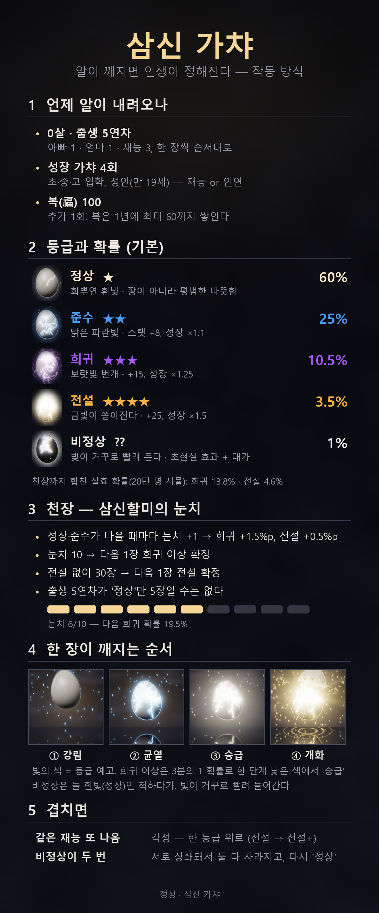
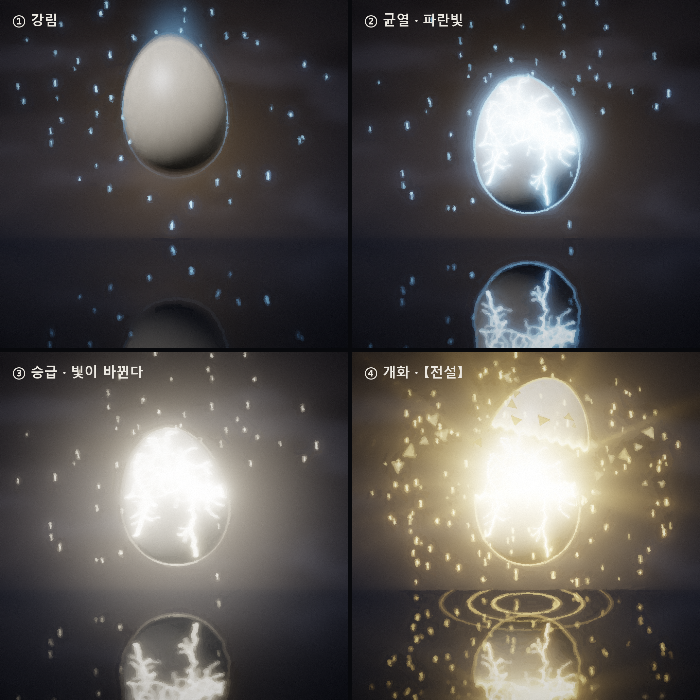
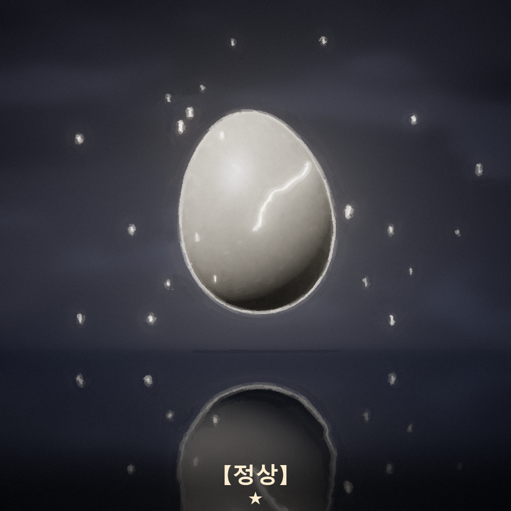
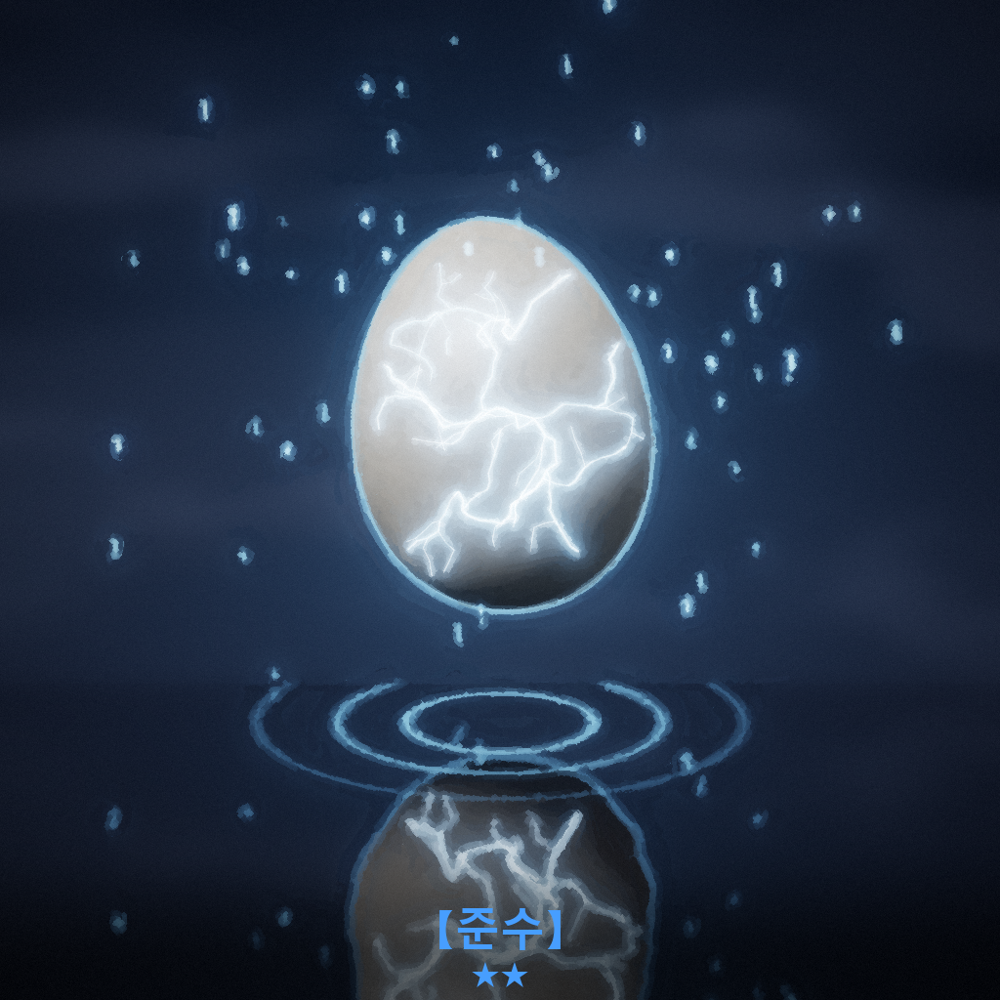
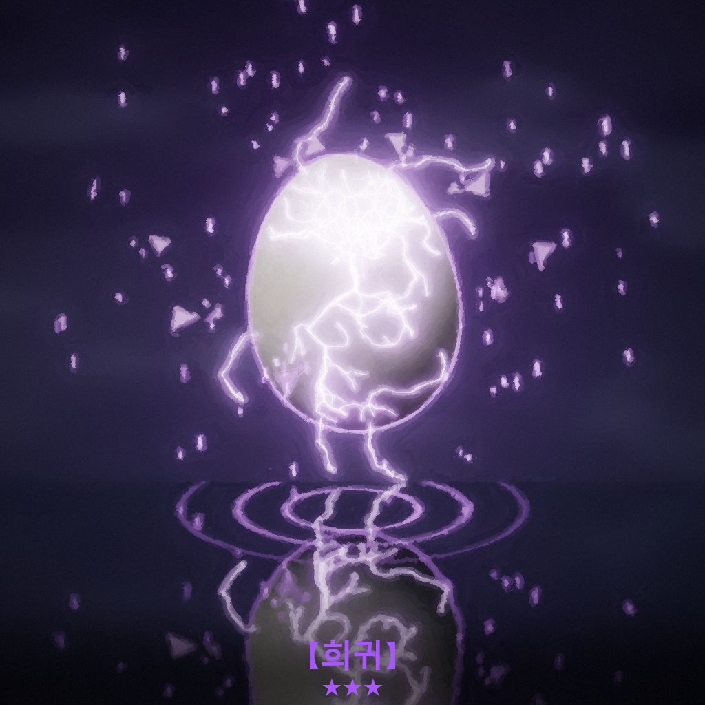
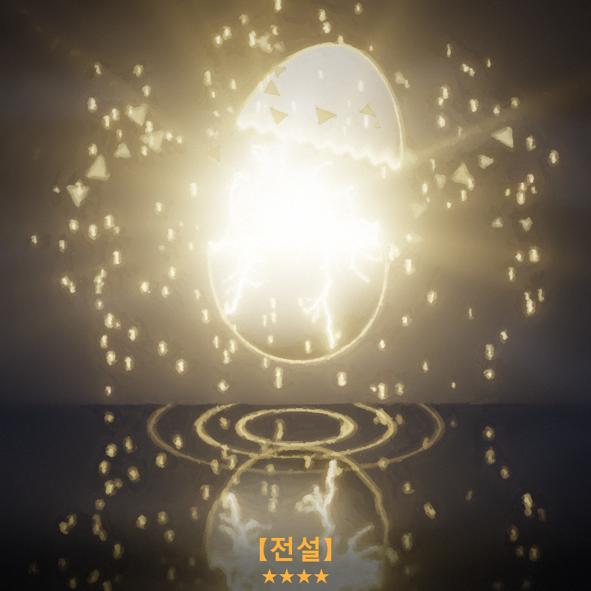
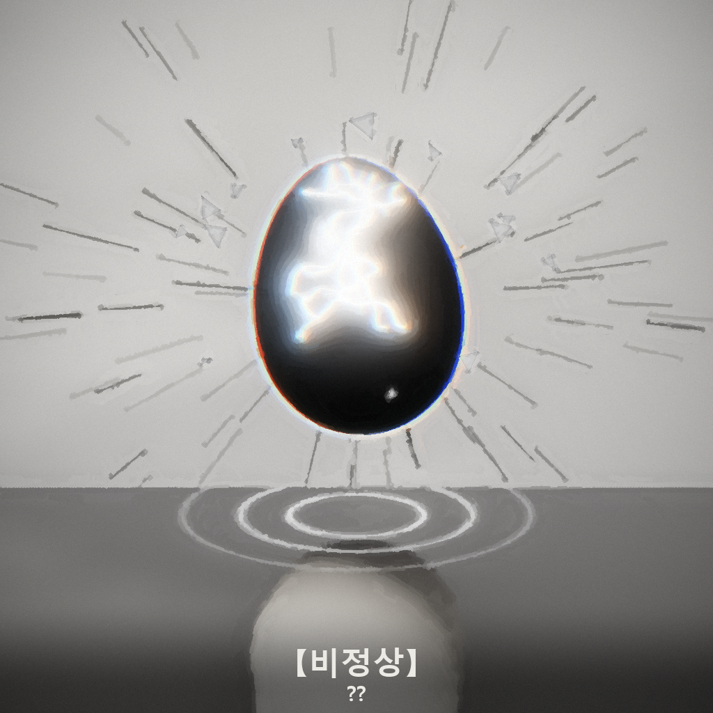

# 삼신 가챠 설계

'정상'의 출생·성장 가챠 시스템이다. 크랙 프롬프트에 붙일 완성본은 [`prompt/gacha_block.txt`](../prompt/gacha_block.txt)에 있다. 이 문서는 왜 그렇게 정했는지를 정리한다.

## 컨셉

- 아이는 삼신할미가 내려보내는 **알**을 깨고 태어난다. 난생설화에서 가져온 설정이고, 0살 출생 시작과 바로 이어진다.
- 룰렛이 아니라 가챠인 이유는 세 가지다. 결과는 고를 수 없고, 등급이 있고, 연출이 보상이고, 천장이 있다.
- 챗 이름이 '정상'이라서 등급 체계 바깥에 **비정상**을 따로 둔다. 초현실주의 요소는 전부 여기로 모은다.

## 등급과 확률

| 등급 | 별 | 빛 (예고 색) | 기본 확률 | 실효 확률* | 보정 |
|---|---|---|---|---|---|
| 정상 | ★ | 희뿌연 흰빛 | 60% | 55.3% | 스탯 +3 |
| 준수 | ★★ | 맑은 파란빛 | 25% | 25.3% | +8, 성장 ×1.1 |
| 희귀 | ★★★ | 보랏빛 번개 | 10.5% | 13.8% | +15, 성장 ×1.25 |
| 전설 | ★★★★ | 금빛 | 3.5% | 4.6% | +25, 성장 ×1.5 |
| 비정상 | ?? | 빛이 안으로 빨려 듦 | 1% | 1.0% | 초현실 효과 + 대가 |

\* 실효 확률은 천장까지 포함해 1인당 9뽑(출생 5 + 성장 4)으로 20만 명을 시뮬레이션한 값이다 (`python tools/gacha_sim.py`).

시뮬레이션에서 나온 체감 수치:
- 출생 5연차의 최고 등급: 준수 32% · 희귀 43% · 전설 19% · 비정상 포함 5%. 정상만 5장은 0%다(보장 규칙).
- 평생 9뽑 중 전설을 1장 이상 받는 사람: 35%
- 평생 9뽑 중 비정상을 1장 이상 받는 사람: 8.7%

## 천장 (눈치 게이지)

- 정상·준수가 나올 때마다 눈치 +1. 게이지 1당 희귀 +1.5%p, 전설 +0.5%p가 붙고, 그만큼 정상에서 빠진다.
- 희귀·전설이 나오면 0으로 돌아간다. 비정상은 게이지를 건드리지 않는다.
- 눈치 10이면 다음 1장은 희귀 75% / 전설 25%로 확정이다.
- 전설 없이 30장을 뽑으면 다음 1장은 전설 확정이다. 9뽑 인생에선 거의 발동하지 않는다. 복으로 많이 뽑는 플레이를 위한 안전장치다.
- 출생 보장: 출생 5연차의 앞 4장이 전부 정상이면 5번째 장에서는 정상이 빠진다.

## LLM에서 굴리는 법

크랙 모델이 확률을 머리로 계산하면 틀리고, 극적인 결과 쪽으로 쏠린다. 그래서 이렇게 한다.
1. 모델은 1~1000 숫자 하나만 굴린다.
2. 프롬프트에 박아 둔 **게이지별 구간표**에서 등급을 찾아본다 (구간표는 `gacha_sim.py`가 계산한다).
3. 등급을 먼저 정하고, 내용은 그다음에 만든다.
4. 굴림값을 카드에 그대로 보여 준다. 플레이어가 확인할 수 있게 하는 게 공정함의 체감이다.

**한계:** LLM이 고르는 '무작위' 숫자는 완전한 무작위가 아니다. 특정 숫자를 선호하는 경향이 있다. 그래서 실제 플레이 확률은 위 표와 다를 수 있다. 출시 전에 30~50번 정도 테스트 뽑기를 해서 등급 분포를 세어 보길 권한다. 많이 쏠리면 구간 배치(희귀 등급을 작은 숫자 쪽에 둔 것)를 바꾸는 게 첫 번째 조정 포인트다.

## 연출 (한 장 = 네 박자)

1. **강림**: 알이 내려온다. 매번 다른 방식으로.
2. **균열**: 금 사이로 새는 빛의 색이 등급 예고다.
3. **승급**: 희귀 이상이고 굴림값이 3의 배수면, 한 단계 낮은 색에서 시작했다가 색이 바뀐다. 굴림 없이 확정된 장은 항상 승급한다. 비정상은 항상 흰빛(정상)인 척하다가 빛이 거꾸로 빨려 들어간다.
4. **개화**: 알이 깨지고 등급 이미지와 결과 카드가 뜬다.

정상 연출은 2~3줄로 짧게 쓰고, 길게 쓰는 건 전설과 비정상뿐이다. 매번 길면 피로해진다.

## 등급 이미지

| 정상 | 준수 | 희귀 | 전설 | 비정상 |
|---|---|---|---|---|
|  |  |  |  |  |

- 비정상 이미지: 실제 알은 검은 알인데 **물에는 멀쩡한 흰 알이 비친다**. 겉으로는 정상인 척하는 등급이라는 뜻이다. 주변 빛도 밖으로 퍼지지 않고 알 쪽으로 빨려 든다.
- 모든 이미지는 코드로 렌더한 뒤 스트로크 페인팅으로 마감했다 (`art/render_gacha.py`, `art/render_guide.py`). 색·구도를 바꾸려면 스크립트의 `TIERS` 값을 고치고 다시 돌리면 된다.

## 비정상 규칙

- 일상의 딱 한 군데만 비틀린다 (마그리트풍). 세상은 그게 정상인 것처럼 굴러간다.
- 효과와 대가는 반드시 같이 온다. 대가는 귀엽거나 쓸쓸한 쪽으로 쓰고, 공포·고어로는 가지 않는다.
- 비정상이 두 번 나오면 서로 상쇄돼서 둘 다 사라진다. 결과는 '정상'이 된다. 제목 '정상'으로 돌아오는 구조다.

## 중복

- 같은 재능이 또 나오면 각성해서 한 등급 위로 간다 (정상→준수→희귀→전설→전설✦).
- 부모는 중복되지 않는다. 같은 인연이 또 나오면 관계가 한 단계 깊어진다.
